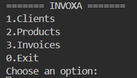

<div align="center">

# INVOXA

### Aplicación de gestión y facturación desarrollada en Java

Proyecto personal para aprender construyendo: desde Java puro hasta una futura aplicación full-stack.


</div>

---

## Sobre el proyecto

**Invoxa** es una aplicación de gestión y facturación que estoy desarrollando por fases. La primera versión utiliza Java puro y una interfaz de consola, con el objetivo de reforzar los fundamentos del lenguaje mediante un proyecto práctico.

La idea también nace de mi experiencia trabajando en una gestoría, que me permite conocer algunos procesos administrativos y pensar qué funcionalidades puede necesitar una aplicación de este tipo.

Durante el desarrollo, utilizo la inteligencia artificial como apoyo para resolver dudas, profundizar en conceptos y revisar posibles mejoras. El código lo escribo yo: quiero comprender qué hace cada parte y las decisiones técnicas que tomo.

## Vista previa

La versión actual funciona desde la consola e incluye un menú para acceder a la gestión de clientes, productos y facturas.



## Funcionalidades actuales

- Gestión de clientes.
- Gestión de productos.
- Creación y gestión de facturas.
- Organización del código mediante clases y servicios.
- Persistencia de clientes, productos y facturas mediante archivos de texto.
- Recuperación de los datos almacenados al iniciar la aplicación.

## Tecnologías y conceptos

- **Java**
- Programación orientada a objetos.
- Colecciones, como `ArrayList`.
- Lectura y escritura de archivos para la persistencia de datos.
- Separación de responsabilidades mediante paquetes y servicios.

## Estructura del proyecto

El código fuente está organizado bajo el paquete raíz `com.invoxa`. Entre los componentes principales se encuentran:

- `Client`: representación de los clientes.
- `Product`: representación de los productos.
- `Invoice`: representación de las facturas.
- `InvoiceLine`: representación de las líneas de factura.
- `services`: lógica de gestión de las funcionalidades.
- `persistence`: lectura y escritura de los datos.
- `init`: punto de entrada de la aplicación.

## Persistencia de datos

La aplicación utiliza archivos de texto para conservar la información entre ejecuciones. Los archivos de datos se encuentran en `data/`:

```text
Invoxa/
├── data/
│   ├── clients.txt
│   ├── products.txt
│   └── invoices.txt
└── src/
    └── main/
        └── java/
            └── com/
                └── invoxa/
                    └── init/
                        └── Main.java
```

El repositorio incluye datos de ejemplo para que puedas probar la aplicación desde el primer momento.

### Empezar desde cero

Si quieres empezar con datos nuevos, vacía el contenido de los archivos de la carpeta `data/` antes de ejecutar la aplicación.

Después podrás crear nuevos clientes, productos y facturas desde el menú. Los datos se guardarán en los archivos correspondientes para las siguientes ejecuciones.

**Importante:** vacía los archivos, pero no los elimines, ya que la aplicación puede esperar que existan al iniciarse.

## Ejecución

1. Clona el repositorio.
2. Abre el proyecto en tu IDE de Java.
3. Comprueba que tienes instalada la versión de Java requerida por el proyecto.
4. Ejecuta el método `main()` de la clase principal:

   `src/main/java/com/invoxa/init/Main.java`

## Roadmap

Invoxa se desarrolla por etapas para poder aprender y validar cada parte antes de avanzar a la siguiente.

| Versión | Rama de Git | Objetivo |
|---|---|---|
| **Java Core** | `version/java` | Aplicación de consola, lógica de negocio y persistencia mediante archivos. |
| **Spring Boot** | `version/spring` | Evolucionar el proyecto hacia un backend y una API REST. |
| **Full Stack** | `version/angular` | Incorporar Angular y conectar el frontend con Spring Boot. |

Cada rama permite trabajar en una etapa del proyecto sin modificar las versiones anteriores. La idea es conservar las versiones de aprendizaje por separado y, cuando la aplicación full-stack esté terminada e integrada, dejar en `main` la versión completa.

> Las etapas de Spring Boot y Angular forman parte del plan de desarrollo; sus funcionalidades se incorporarán cuando estén implementadas.

## Objetivo

El objetivo de Invoxa no es únicamente terminar una aplicación, sino consolidar conocimientos, aprender nuevas tecnologías con una base práctica y documentar la evolución del proyecto.

---

<div align="center">

**Invoxa · Proyecto personal de aprendizaje y desarrollo de software**

</div>
